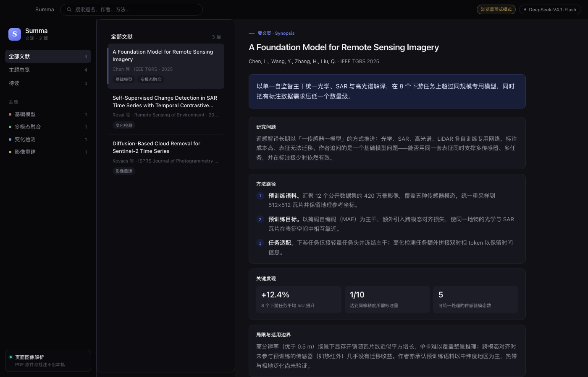

# Summa · 文渊

> Read less. Know more. —— 一页见要旨。

Summa 是一个用大模型读论文的桌面文献管理工具。把 PDF 拖进窗口，它会让 DeepSeek 读页面图像，生成一页「要义页」：一句话要旨、研究问题、方法路径、关键发现、局限与适用边界，并自动归入主题。

**数据在你的机器上**：文献库是一个 JSON 文件，PDF 副本存在本地目录。只有两处外发，都由你触发——解析时把页面图像发给 DeepSeek；启用同步时把库和原文发到**你自己的** WebDAV 服务器。不启用同步，除解析外不出本机。

和只讲贡献的摘要工具不同，要义页专门有「局限与适用边界」一节，帮你判断这篇论文能不能用在自己的场景里。



## 能做什么

- **解析**：拖入 PDF（可多篇），自动生成要义页并归类，PDF 副本保存在本机
- **整理**：主题（编辑、重命名、合并、删除）、已读 / 待读、星标、个人笔记、批量操作
- **查找**：全文关键词搜索（含笔记）、按主题和状态筛选、多种排序
- **同步**：通过 WebDAV 同步到自己的 NAS（群晖、极空间、Nextcloud 等），两台机器各自新增的文献都保留，删除不会被复活
- **引用**：一键复制 APA 格式引用，一键打开原文 PDF
- **外部导入**：在 WorkBuddy / Claude Code 里读完论文，说「存到 Summa」即可入库，也能反过来检索你的库
- **外观**：日间 / 夜间主题，可跟随系统

## 文档导航

| 我想… | 看这里 |
|---|---|
| 安装、配置、日常使用 | [使用手册](app/INSTALL.md) |
| 在 WorkBuddy / Claude Code 里导入论文 | [使用手册 · 从 AI 工具导入](app/INSTALL.md#7-从-ai-工具导入) |
| 同步到自己的 NAS | [使用手册 · 同步](app/INSTALL.md#8-同步到-naswebdav) |
| 修改或二次开发 | [开发指南](app/README.md) |
| 了解各版本改了什么 | [更新日志](CHANGELOG.md) |
| 同步的合并规则与冲突处理 | [同步技术方案](docs/03-sync-spec.md) |
| 外部工具导入的数据格式与规则 | [外部工具集成方案](docs/02-integration-spec.md) |
| 解析链路的设计与取舍 | [解析链路技术方案](docs/01-parsing-spec.md) |
| 品牌、术语、视觉规范 | [品牌与命名基线](docs/00-brand-naming.md) |

## 项目结构

```
wenxian/
├── app/                      桌面应用（Tauri 2 + React + TypeScript）
│   ├── src/                  界面
│   ├── src-tauri/            Rust 端：文件、网络、文献库读写
│   ├── README.md             开发指南
│   └── INSTALL.md            使用手册
├── skills/summa-import/      WorkBuddy / Claude Code 技能：导入与检索
│   ├── SKILL.md
│   └── scripts/summa.py
├── docs/                     设计文档
├── prototype/                早期界面原型（单文件 HTML）
├── server/                   已停用的 HTTP 服务（被收件箱方案取代）
└── CHANGELOG.md              更新日志
```

## 快速开始

需要 Node.js 20+ 与 Rust 1.77+；macOS 另需 Xcode Command Line Tools，Windows 需 MSVC 构建工具与 WebView2 运行时。

```bash
cd app
npm install
npm start             # 开发模式，改界面即时热更新
npm run tauri build   # 打包，产物在 src-tauri/target/release/bundle/
```

Windows 上打包需要显式指定安装包格式（配置里默认只出 macOS 的 `.app`）：

```bash
npm run tauri build -- --bundles nsis
```

首次打开后点右上角「未配置 API Key」，填入自己的 DeepSeek Key（也可在设置里填），然后就可以把 PDF 拖进窗口了。详细步骤见[使用手册](app/INSTALL.md)。

Key 由你自备，程序不内置、不上传第三方，只保存在本机配置文件里。

## 平台

代码按跨平台写，使用 Tauri 2，同一套界面在 macOS 与 Windows 上运行。

**目前只在 macOS 上实测过**，Windows 未验证——如果你在 Windows 上跑通了或遇到问题，欢迎开 Issue。

## 费用

解析按页渲染后交给模型，一篇 24 页论文约 9 万 token，按 DeepSeek 现价约 0.09 元。费用直接结算在你的 DeepSeek 账户，本项目不涉及任何付费环节。

## 许可

[MIT](LICENSE)。可自由使用、修改、分发，包括商业用途。

